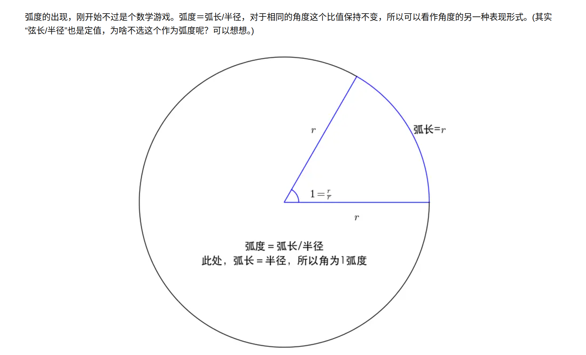
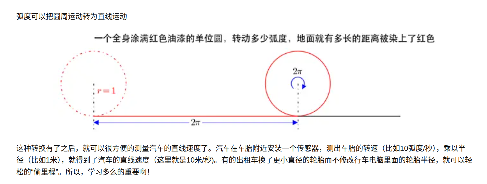
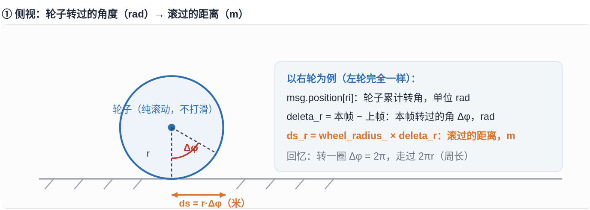
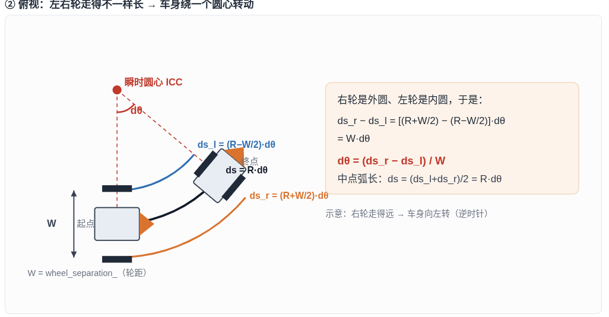
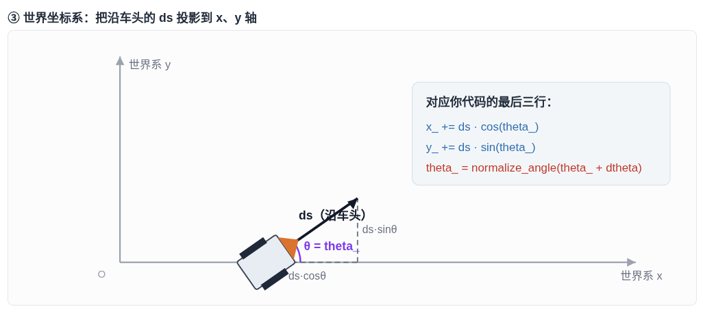
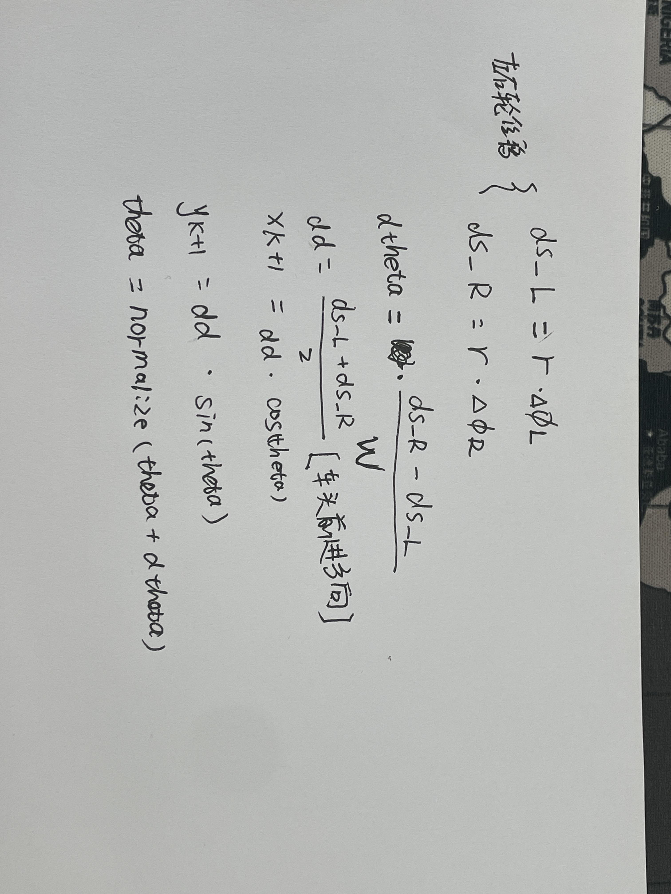
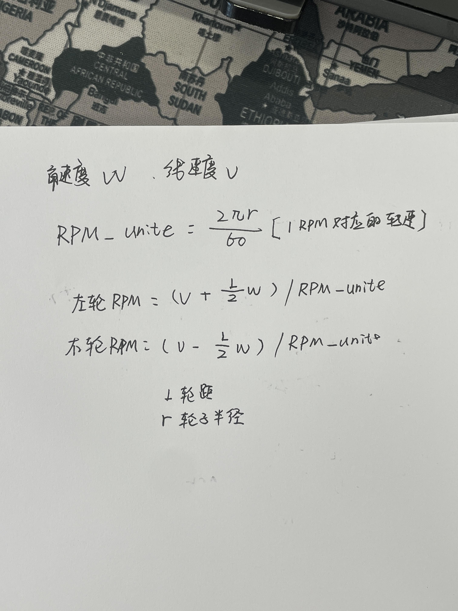

## 前言

最近刚好从事扫地机器人的工作。读书那会儿做过一些无人机算法的研究，现在基于以往的基础 + AI 辅助学习，把当前对扫地机器人算法和底盘控制的理解记录下来，供后续参考。

## 一、基础概念：弧度

**弧度 = 弧长 / 圆的半径**，即 $\varphi = s / r$；反过来，弧长 $s = r\varphi$。

基于弧长公式，我们可以把圆周运动和直线运动互相换算，所以在轮式机器人中，弧度是一个非常基础且重要的概念。比如轮子转一圈，对应的弧度是 $2\pi$，在地面上滚过的距离就是一个周长 $2\pi r$。





## 二、编码器数据：从 tick 到轮子弧度

机器人的运动一般是上位机发送指令给底盘驱动电机。但只驱动、不反馈，机器人就像无头苍蝇，后续的定位、建图等算法都无法开展。这个反馈一般来自电机编码器采集的数据。

MCU 一般不会直接给出弧度，而是给出 **tick 脉冲计数**（一圈对应固定数量的脉冲）。

### 2.1 计数绕圈（溢出）处理

以一圈 32768 个 tick 为例：

```c
#define POSITION_CIRCLE  32768L
```

编码器是累计计数，计到 32768 后会回到 0 重新开始。因此不能直接用当前值 `pos` 做差，需要结合上一次的 `last_pos` 计算真实增量 `encoding_num`：

```c
long delta = pos - last_pos;

// 正向越过了一圈边界（从最大值跳回 0），差值表现为一个接近 +一圈 的大数
if (delta > POSITION_CIRCLE / 2) {
    delta -= POSITION_CIRCLE;
}
// 反向越过了一圈边界（从 0 跳回最大值）
else if (delta < -POSITION_CIRCLE / 2) {
    delta += POSITION_CIRCLE;
}

long encoding_num = delta;
```

原理：正常情况下两轮读数之间的差值不会超过半圈；一旦差值超过半圈，说明中间发生了绕圈，补/减一圈即可。

### 2.2 tick → 弧度

拿到本帧的真实脉冲数后，按比例换算成弧度：

$$
\varphi = \frac{\text{encoding\_num}}{\text{POSITION\_CIRCLE}} \times 2\pi
$$

左右轮处理方式相同。

## 三、正运动学：从轮子弧度到里程计

有了左右轮的弧度，如何计算车身的位置和朝向？这就是里程计（Odometry，简称 Odom）。

### 3.1 先约定坐标系

全文采用机器人领域通用的右手坐标系：

- 世界坐标系（odom 系）：**x 轴向前，y 轴向左，z 轴向上**；
- 车头朝向角 $\theta$：车头正前方与世界系 x 轴的夹角，**逆时针为正**；
- 轮距记为 $L$（`wheel_separation`），轮子半径记为 $r$（`wheel_radius`）。

### 3.2 第一步：轮子弧度 → 单轮走过的距离

由弧长公式：

$$
ds_l = r \cdot \Delta\varphi_l, \qquad ds_r = r \cdot \Delta\varphi_r
$$



### 3.3 第二步：左右轮差 → 车身转动量

当左右轮走过的距离不相等时，车身会绕一个**瞬时圆心（ICC, Instantaneous Center of Curvature）**做圆周运动。

设中点转弯半径为 $R$，则左轮半径为 $R-L/2$，右轮半径为 $R+L/2$，本帧转过角度为 $d\theta$：

$$
ds_l = (R-L/2)\,d\theta, \qquad ds_r = (R+L/2)\,d\theta
$$

两式相减，半径 $R$ 被消掉：

$$
ds_r - ds_l = L \cdot d\theta
$$

于是得到本帧的转角，以及车中点走过的距离（两式相加除以 2）：

$$
\boxed{\,d\theta = \frac{ds_r - ds_l}{L}\,}, \qquad
ds = \frac{ds_l + ds_r}{2}
$$



### 3.4 第三步：投影到世界坐标系

车中点沿车头方向走了 $ds$，把它投影到世界系的 x、y 轴上，并更新航向：

$$
x \mathrel{+}= ds \cdot \cos\theta
$$

$$
y \mathrel{+}= ds \cdot \sin\theta
$$

$$
\theta = \text{normalize\_angle}(\theta + d\theta)
$$

这里 $d\theta$ 是车身在固定世界平面上的转动量，与 $\theta$ 描述的是同一个平面内的角度，因此可以直接相加。`normalize_angle` 只负责把角度折回 $[-\pi, \pi)$，防止数值无限累积，并不改变实际指向。



### 3.5 完整公式



通过以上步骤，就从编码器数据积分出了机器人相对于初始原点的位置 $(x, y)$ 和车头角度 $\theta$，这就是里程计信息（ROS 中对应 `nav_msgs/Odometry`）。

## 四、逆运动学：从速度指令到左右轮转速

上面的链路反过来，就是上层算法控制电机的过程。

一般 SoC 给 MCU 的控制指令不是直接给转速，而是给出**线速度 $v$ 和角速度 $\omega$**（ROS 中对应 `geometry_msgs/Twist`）。

### 4.1 差速逆解

把正运动学公式反过来，即可得到左右轮各自需要的线速度：

$$
\boxed{\,v_l = v - \omega \cdot L/2\,}, \qquad
\boxed{\,v_r = v + \omega \cdot L/2\,}
$$

$\omega$ 为正（左转）时，右轮是外侧轮，需要更快。



### 4.2 线速度 → 转速 rpm

若电机驱动接收的是转速 rpm，先算 1 rpm 对应的线速度：

$$
\text{rpm\_unit} = \frac{2\pi r}{60} \quad (\text{m/s，每 rpm})
$$

再用轮速除以它：

$$
n_l = \frac{v_l}{\text{rpm\_unit}} = \frac{v_l \cdot 60}{2\pi r}, \qquad
n_r = \frac{v_r \cdot 60}{2\pi r}
$$

> 自检方法：把算出来的两轮速度代回正运动学，$(v_l+v_r)/2$ 应等于 $v$，$(v_r-v_l)/L$ 应等于 $\omega$。两条同时成立，符号就没搞反。

### 4.3 注意减速比

电机带减速箱时（减速比 $G$：电机转 $G$ 圈、轮轴转 1 圈）：

- **电机轴 rpm = 轮轴 rpm × G**；
- 若编码器装在电机轴上，则轮轴转一圈对应 $G \times \text{POSITION\_CIRCLE}$ 个 tick。

到底发给驱动的是电机轴转速还是轮轴转速，务必看驱动文档。

## 五、总结：里程计的局限

可以看到，基于速度指令驱动电机、再对电机编码器数据做积分，我们就能得到当前机器人的位置。但这个位置一定准确吗？

- 如果轮子一直打滑、空转，积分出的位置会明显偏离真实位置；
- 即使不打滑，轮径、轮距的标定误差也会随时间累积，误差越来越大。

所以单纯靠编码器无法满足长期定位需求，这就引出了下一个话题——**传感器融合**（如轮式里程计 + IMU + 激光/视觉），后续再介绍。
